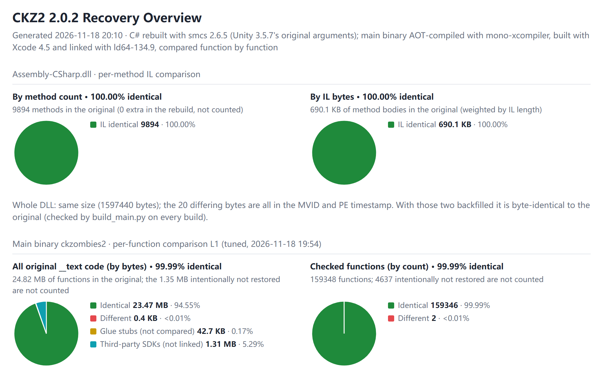

# Contract Killer: Zombies 2 Reverse

**English** | [中文](README_CN.md)

## Overview

This project is based on Glu Mobile's *Contract Killer: Zombies 2* for iOS, version 2.0.2 (`com.glu.ckzombies2`). The game was made with Unity 3.5.7f6: its C# scripts are compiled into `Assembly-CSharp.dll`, which Mono then fully AOT-compiles into the main executable `ckzombies2` (armv7 Mach-O). The original executable is not stripped and still carries its complete STABS debug map: every AOT method has a name, and the compilation units, build paths and link order of the native code are all on record.

The goal is a **1:1 source recovery**: compiling the recovered sources with the original toolchain must produce an `Assembly-CSharp.dll` that is byte-identical to the original, and from it an identical `ckzombies2`. Fixing the game's bugs is out of scope; the original behavior, including its own bugs, is kept as is.

Fixes and ports built on top of this source only make sense if the source itself can be trusted.

The executable has four layers, each recovered and verified differently:

| Layer | Contents | Approach | Verification |
| --- | --- | --- | --- |
| C# | `Assembly-CSharp.dll`: 579 source files, 9,894 methods | Decompile, then bring each method's code back to its original form | Per-method IL identical; with MVID and timestamp backfilled, the whole DLL is byte-identical |
| AOT | 72% of the executable's `__text`, generated from the DLLs | Not hand-written: regenerated with the original AOT compiler and arguments | Re-AOT of the original DLL gives a `__text` byte-identical to the original (relocations aside) |
| Native code | Xcode project template and Glu's native plugins | 14 plugins recovered; 11 ad, analytics and networking plugins stubbed | Function-by-function comparison |
| Link | Unity engine library, Mono runtime, third-party SDKs | Linked with the original arguments and order | Function, data-chunk and structure comparison after linking |

## Compiler, SDK and third-party libraries

The versions are derived from the `.app`'s `Info.plist`, the build and SDK paths in the debug map, and function-by-function machine-code comparison.

> ✅ matched　⚠️ same version, but one aspect cannot be fully verified　❓ original version unknown

### Toolchain

| Component | Original | This project | Match | Notes |
| --- | --- | --- | :---: | --- |
| Unity | 3.5.7f6 | 3.5.7f6 macOS installer | ✅ | The game's 5 bundled framework DLLs and `UnityEngine.dll` are byte-identical to the installer's |
| C# compiler | smcs 2.6.5.0, running on the Mac Mono bundled with Unity | The same smcs.exe on the same Mac Mono | ✅ | Arguments as in the Unity 3.5.7 editor: `-debug -target:library -nowarn:0169`. The DLL is byte-identical to the original except for MVID and timestamp |
| AOT compiler | mono-xcompiler (Mono 2.6.5, bundled with Unity 3.5.7) | Same | ✅ | `--aot=full,asmonly,nodebug,ntrampolines=4096,nrgctx-trampolines=4096,nimt-trampolines=4096,static` |
| Compiler, assembler | Xcode 4.5 (4G182): clang-421.11.65 | Same | ✅ | `Info.plist`: `DTXcodeBuild=4G182`; not 4.5.1 / 4.5.2 (both ship clang-421.11.66) |
| Linker | ld64-134.9 (same Xcode) | Same | ⚠️ | Header, load commands, dylib order and weak linking, and function order match the original; the whole file is not byte-identical yet (third-party SDKs missing) |
| iOS SDK | iOS 6.0 SDK (10A403) | Same | ✅ | `Info.plist`: `DTSDKBuild=10A403`; minimum OS 5.1 |
| Native compiler flags | — | Unity template Release configuration + Glu's changes: `-Os -mno-thumb -g -fvisibility=hidden` | ✅ | Derived from functions that match byte for byte; all original symbols are private extern and ObjC classes carry `RO_HIDDEN`, which proves `-fvisibility=hidden` |
| Linker flags | — | `-all_load -dead_strip` | ✅ | Only this combination pulls in exactly the 551 `libiPhone-lib.a` members listed in the original debug map, in the same order |
| Build path | `/Applications/buildAgent/work/a03c2b4a5f58e0ef/GeneratedProject_ios` | Same | ✅ | `__FILE__` strings and debug-info paths match the original |

Unity's Mac Mono and mono-xcompiler are i386 Mach-O programs; Xcode 4.5's clang, ld and as are x86_64 Mach-O. This project runs them directly on Linux with a patched [maloader](https://github.com/shinh/maloader); the patches and the shim are in [`toolchain/`](toolchain/README.md).

**Why the build must use the Mac Mono**: the Windows smcs produces the same method IL, but not the same DLL. The original references the unity-profile mscorlib 2.0.5.0, while the Windows build defaults to 2.0.0.0; and the order of the CustomAttribute table depends on how the C library's `qsort` treats equal elements, and the original used Apple Libc's implementation. The shim contains a transcription of Apple Libc's `qsort`.

### Third-party libraries

| Library | Source | This project | Notes |
| --- | --- | --- | --- |
| EZ GUI | Unity plugin (C# source) | Recovered in `Assets/Packages/EZGUI/` | Compiled into `Assembly-CSharp.dll` and matched method by method like the game code |
| LitJSON | Third-party managed library (built with Microsoft csc) | Original file in `Assets/3rd_party/LitJSON.dll` | Out of scope; used as is for compile references and AOT |
| Unity engine library, Mono runtime | `libiPhone-lib.a` from the Unity 3.5.7 installer | Taken from the installer at build time | Linked directly |
| Tapjoy, Kontagent, Flurry, MobileAppTracking, PlayHaven, Facebook SDK | Prebuilt libraries | **Stubs** in `native_stubs/` | Ad / analytics SDKs; **not original code**, only there so the game links and runs. The calls on the C# side are kept |
| In-app purchase, purchase verification | Glu plugins relying on online services | **Stubs** in `native_stubs/` | Same as above |

## Results



All 9,894 methods of the C# layer have IL identical to the original; with the MVID and timestamp backfilled, `Assembly-CSharp.dll` is byte-identical to the original.

Function-by-function comparison of the executable: of the 159,348 checked functions, 159,346 match the original. The 2 that differ are COM interop wrappers in mscorlib: the AOT compiler wrote a heap address from the build machine's process into the code as a constant. That value cannot be reproduced, and iOS never calls these wrappers. Third-party SDKs and glue stubs are out of scope and not counted in the percentages.

See the [progress page](docs/progress.en.html) for the full page.

## Build

The build runs on Linux. On Windows, the scripts create a dedicated WSL distro in the repository's `.wsl\` folder; it does not use the C: drive and does not touch existing WSL distros. The build does not need any original game files.

### Requirements

| Item | Requirement |
| --- | --- |
| OS | Windows 10 / 11 (x64) with WSL 2, or x86_64 Ubuntu 24.04 |
| WSL | If not installed, run `wsl --install --no-distribution` in an administrator PowerShell and reboot |
| Xcode 4.5 | **Bring your own**: `xcode_4.5.dmg` (4G182, 1.6 GB, SHA-256 `f7c8e0cd…54194dec440`); downloading it requires an Apple ID, see below |
| Downloaded automatically | Ubuntu 24.04 WSL image (about 350 MB); Unity 3.5.7 macOS installer (about 980 MB); apt packages; maloader source |
| Disk | About 10 GB: the WSL distro's virtual disk takes about 7 GB (it does not shrink after the temporary unpacking files are deleted), the installers about 3 GB |

To download Xcode 4.5, sign in to Apple Developer, then open this address in the same browser:

```
https://developer.apple.com/services-account/download?path=/Developer_Tools/xcode_4.5/xcode_4.5.dmg
```

Or search for `Xcode 4.5` on [More Downloads](https://developer.apple.com/download/all/) and pick **Xcode 4.5** (not 4.5.1 or 4.5.2). Rename the file to `Xcode_4.5.dmg` and put it in `toolchain\downloads\`.

### Steps (Windows)

1. **Set up the environment** (once): double-click `setup.bat`. If the dmg is somewhere else, run `setup.bat <path to dmg>` from a command prompt. The script:
   - downloads the Ubuntu 24.04 WSL image, checks its SHA-256 and imports it as the distro `ckz2-build` (disk in `.wsl\ckz2-build\`);
   - downloads the Unity 3.5.7 macOS installer to `toolchain\downloads\`;
   - installs the build dependencies and builds a 64-bit and a 32-bit maloader from a pinned commit plus patches;
   - checks the SHA-256 of both dmgs and unpacks what is needed, then runs smcs, mono-xcompiler, clang, as and ld once and AOT-compiles and assembles one assembly as a self-check.
2. **Build**: double-click `build.bat`. It compiles `Assembly-CSharp.dll` and checks that it matches the original, then runs AOT, compiles the native code and links `ckzombies2`.
3. The output is in `bin\`: `bin\ckzombies2` and the 8 assemblies in `bin\Data\Managed\`, laid out like `ckzombies2.app`. Intermediate files are in `build\`.

`bin\ckzombies2` carries an ad-hoc signature with the original entitlements. Without a signature the executable gets no keychain access, and the game shows "cannot connect to server" on launch.

### Steps (Linux)

On x86_64 Ubuntu 24.04, run the same scripts directly:

```bash
sudo bash toolchain/setup_distro.sh /path/to/Xcode_4.5.dmg
```

```bash
sudo bash toolchain/build.sh
```

The build uses `/work` and creates the original build path under `/Applications/buildAgent/...`, so a dedicated virtual machine or container is recommended.

### Running

You need a jailbroken iOS device with *Contract Killer: Zombies 2* version 2.0.2 installed. Copy the contents of `bin/` over `ckzombies2.app`.

## Where the source directories come from

The original source tree was not preserved. Unity passes the source files to smcs in alphabetical path order, and the type order follows the paths, so directory names affect verification: the inferred paths must sort in the same order as the original, or the DLL will not match. Conversely, as long as the order is the same, the comparison cannot tell whether a name is right. The evidence level of each type:

| Level | Types | Meaning |
| --- | ---: | --- |
| `po` | 63 | Full path from a localization PO comment |
| `bracketed` | 64 | MonoBehaviour subclass (file name = class name) enclosed by two anchors in the same directory |
| `anchor` | 136 | Directory known from an anchor; file name inferred from the class-name rule or the order |
| `evidence` | 1 | `Packages/ABTesting/Examples/`; the DLL contains this path string |
| `package` | 276 | Package directory `Packages/<name>/` from the log name `Package.<name>` and the original order; subdirectories inside packages and EZ GUI's internal layout are guesses |
| `guess` | 164 | Directory name is a guess (e.g. `Scripts/Camera`, `Scripts/Utils`) |

The guessed parts are only guaranteed to sort correctly; whether the names match the original cannot be verified.

## Layout

| Path | Contents |
| --- | --- |
| `Assets/` | Recovered sources, laid out like the original Unity project: `Packages/` (Glu's shared packages and EZ GUI), `Scripts/` (game code), `Plugins/iOS/` (the 14 recovered Glu native plugins, plus `AppController.mm`, the template file Glu modified), `3rd_party/LitJSON.dll` (original third-party managed library) |
| `native_stubs/` | Stubs for the 11 ad, analytics and networking native plugins (not original code) |
| `toolchain/` | Setup and build scripts, maloader patches, the link order and entitlements exported from the original; see [`toolchain/README.md`](toolchain/README.md) (Chinese) |
| `docs/` | Progress pages (English / Chinese) and pie charts |
| `setup.bat` / `build.bat` | One-click entry points for Windows |

## Disclaimer

- This project is not affiliated with, authorized or endorsed by Glu Mobile or its affiliates.
- The name, trademarks, art, audio, levels and other game content of the Contract Killer series, as well as the original program, are the property of their respective owners.
- This repository contains the recovered source code and build scripts, plus the original file of the third-party managed library `LitJSON.dll`. It does not contain the original executable, game data files, Unity or Xcode. Running it requires a legally obtained copy of the game.
- This project is for learning, research and preservation only, and may not be used commercially.
- The code is provided "as is", without warranty of any kind; use at your own risk.
