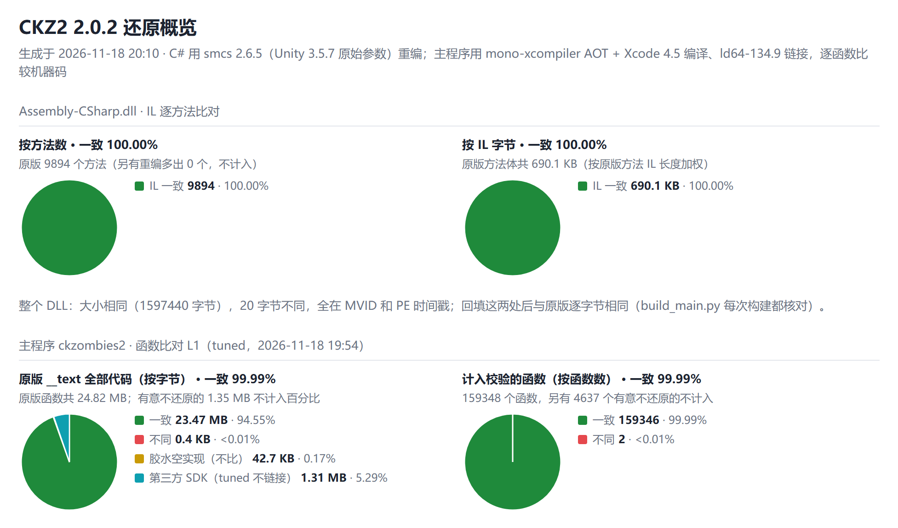

# Contract Killer: Zombies 2 Reverse

[English](README.md) | **中文**

## 概述

本项目基于 Glu Mobile《Contract Killer: Zombies 2》iOS 2.0.2 版本（`com.glu.ckzombies2`）。游戏用 Unity 3.5.7f6 开发，C# 脚本编成 `Assembly-CSharp.dll`，再由 Mono 全量 AOT 编进主程序 `ckzombies2`（armv7 Mach-O）。原版主程序没有剥离符号，还保留了完整的 STABS 调试映射：每个 AOT 方法都有名字，原生代码的编译单元、构建路径和链接顺序都有据可查。

本项目的目标是 **1:1 还原源码**：用原版工具链编译还原出的源码，得到与原版逐字节一致的 `Assembly-CSharp.dll`，进而得到一致的 `ckzombies2`。修复游戏原本的 bug 不在本项目范围内，原版行为（包括原版自身的 bug）一律按原样保留。

只有源码具备极高的可信度，后续的修复和移植才有实际意义。

主程序分四层，每层的做法和校验方法不同：

| 层 | 内容 | 做法 | 校验 |
| --- | --- | --- | --- |
| C# | `Assembly-CSharp.dll`：579 个源文件、9,894 个方法 | 反编译后逐方法把写法调回原样 | 逐方法 IL 一致；回填 MVID 与时间戳后整个 DLL 逐字节一致 |
| AOT | 主程序 `__text` 的 72%，由 DLL 生成 | 不手写，用原版的 AOT 编译器和参数重新生成 | 原版 DLL 重新 AOT 后，`__text` 与原版逐字节一致（重定位位置除外） |
| 原生代码 | Xcode 工程模板与 Glu 原生插件 | 已还原 14 个插件；广告、统计、联网类 11 个做空实现 | 逐函数比对 |
| 链接 | Unity 引擎库、Mono 运行时、第三方 SDK | 按原版参数和顺序链接 | 链接后逐函数、逐数据块、逐结构项比对 |

## 编译器、SDK 与第三方库

版本依据来自 `.app` 的 `Info.plist`、调试映射里的构建路径和 SDK 路径，以及逐函数的机器码比对。

> ✅ 已对齐　⚠️ 版本一致，但有一项无法完全核实　❓ 原版版本未确定

### 工具链

| 组件 | 原版 | 本项目 | 对齐 | 备注 |
| --- | --- | --- | :---: | --- |
| Unity | 3.5.7f6 | 3.5.7f6 macOS 安装包 | ✅ | 游戏自带的 5 个框架 DLL 和 `UnityEngine.dll` 与安装包里的同名文件逐字节相同 |
| C# 编译器 | smcs 2.6.5.0，跑在 Unity 自带的 Mac 版 Mono 上 | 同一个 smcs.exe，跑在同一个 Mac 版 Mono 上 | ✅ | 参数照 Unity 3.5.7 编辑器：`-debug -target:library -nowarn:0169`。编出的 DLL 除 MVID 和时间戳外与原版逐字节相同 |
| AOT 编译器 | mono-xcompiler（Mono 2.6.5，Unity 3.5.7 自带） | 同左 | ✅ | `--aot=full,asmonly,nodebug,ntrampolines=4096,nrgctx-trampolines=4096,nimt-trampolines=4096,static` |
| 编译器、汇编器 | Xcode 4.5（4G182）：clang-421.11.65 | 同左 | ✅ | `Info.plist`：`DTXcodeBuild=4G182`；不是 4.5.1 / 4.5.2（两者都是 clang-421.11.66） |
| 链接器 | ld64-134.9（同一 Xcode） | 同左 | ⚠️ | 文件头、加载命令、dylib 顺序和弱链接、函数排列顺序与原版一致；整文件尚未逐字节一致（缺第三方 SDK） |
| iOS SDK | iOS 6.0 SDK（10A403） | 同左 | ✅ | `Info.plist`：`DTSDKBuild=10A403`；最低系统版本 5.1 |
| 原生编译参数 | — | Unity 模板 Release 配置 + Glu 的改动：`-Os -mno-thumb -g -fvisibility=hidden` | ✅ | 由逐函数一致的结果反推；原版符号全是 private extern，ObjC 类带 `RO_HIDDEN`，可证明开了 `-fvisibility=hidden` |
| 链接参数 | — | `-all_load -dead_strip` | ✅ | 只有这样，`libiPhone-lib.a` 被链进来的 551 个成员才与原版调试映射完全相同、顺序一致 |
| 构建路径 | `/Applications/buildAgent/work/a03c2b4a5f58e0ef/GeneratedProject_ios` | 同左 | ✅ | `__FILE__` 字符串和调试信息里的路径与原版相同 |

Unity 的 Mac 版 Mono、mono-xcompiler 是 i386 Mach-O，Xcode 4.5 的 clang、ld、as 是 x86_64 Mach-O。本项目用打了补丁的 [maloader](https://github.com/shinh/maloader) 在 Linux 上直接运行它们，补丁和垫片见 [`toolchain/`](toolchain/README.md)。

**为什么必须在 Mac 版 Mono 上编**：Windows 版 smcs 编出的方法 IL 与原版相同，但整个 DLL 对不上。原版引用的是 unity 配置的 mscorlib 2.0.5.0，而 Windows 版默认用 2.0.0.0；CustomAttribute 表的排列取决于 C 库 `qsort` 处理相等元素的方式，原版用的是 Apple Libc 的实现。本项目在垫片里照 Apple Libc 转写了一份 `qsort`。

### 第三方库

| 库 | 来源 | 本项目 | 备注 |
| --- | --- | --- | --- |
| EZ GUI | Unity 插件（C# 源码） | 还原在 `Assets/Packages/EZGUI/` | 编进 `Assembly-CSharp.dll`，与游戏代码一样逐方法对齐 |
| LitJSON | 第三方托管库（微软 csc 编译） | 原件 `Assets/3rd_party/LitJSON.dll` | 不在还原范围，原样参与编译引用和 AOT |
| Unity 引擎库、Mono 运行时 | Unity 3.5.7 安装包里的 `libiPhone-lib.a` | 构建时从安装包取 | 直接链接 |
| Tapjoy、Kontagent、Flurry、MobileAppTracking、PlayHaven、Facebook SDK | 预编译库 | **空实现**，在 `native_stubs/` | 广告/统计 SDK，**不是原版代码**，只为能链接、能玩；C# 侧的调用照样保留 |
| 应用内购买、购买校验 | Glu 插件，依赖联网服务 | **空实现**，在 `native_stubs/` | 同上 |

## 结果



C# 层 9,894 个方法的 IL 全部与原版一致，回填 MVID 和时间戳后，`Assembly-CSharp.dll` 与原版逐字节相同。

主程序逐函数比对：计入校验的 159,348 个函数里，159,346 个与原版一致。不同的 2 个是 mscorlib 里的 COM 互操作包装：AOT 编译器把构建机进程里的一个堆地址当常数写进了代码，这个值无法复现，iOS 上也不会调用到它们。第三方 SDK 和胶水空实现不在还原范围内，不计入百分比。

完整页面见 [进度页](docs/progress.cn.html)。

## 构建

构建在 Linux 里进行。Windows 上由脚本自动创建一个专用的 WSL 发行版，放在本仓库的 `.wsl\` 目录下，不占 C 盘，也不影响已有的 WSL 发行版。构建全程不需要原版游戏文件。

### 环境要求

| 项目 | 要求 |
| --- | --- |
| 系统 | Windows 10 / 11（x64），已启用 WSL 2；或者 x86_64 的 Ubuntu 24.04 |
| WSL | 未安装时，在管理员 PowerShell 中运行 `wsl --install --no-distribution` 后重启 |
| Xcode 4.5 | **需要自备**：`xcode_4.5.dmg`（4G182，1.6 GB，SHA-256 `f7c8e0cd…54194dec440`），下载需要 Apple ID，见下文 |
| 自动下载 | Ubuntu 24.04 WSL 镜像约 350 MB；Unity 3.5.7 macOS 安装包约 980 MB；apt 软件包；maloader 源码 |
| 磁盘 | 约 10 GB：WSL 发行版的虚拟磁盘约 7 GB（解包时的临时文件删除后，虚拟磁盘不会自动缩小），安装包约 3 GB |

Xcode 4.5 的下载方法：登录 Apple Developer 后，在同一浏览器中打开

```
https://developer.apple.com/services-account/download?path=/Developer_Tools/xcode_4.5/xcode_4.5.dmg
```

或者在 [More Downloads](https://developer.apple.com/download/all/) 搜索 `Xcode 4.5`，选 **Xcode 4.5**（不是 4.5.1、4.5.2）。下载后改名为 `Xcode_4.5.dmg`，放到 `toolchain\downloads\` 下。

### 步骤（Windows）

1. **准备环境**（只需做一次）：双击 `setup.bat`。如果 dmg 放在别处，在命令行中运行 `setup.bat <dmg 路径>`。脚本会：
   - 下载 Ubuntu 24.04 WSL 镜像并核对 SHA-256，导入为发行版 `ckz2-build`（磁盘在 `.wsl\ckz2-build\`）；
   - 下载 Unity 3.5.7 macOS 安装包到 `toolchain\downloads\`；
   - 安装编译依赖，按固定提交编译 64 位和 32 位两份 maloader 并打补丁；
   - 核对两个 dmg 的 SHA-256，解出需要的部分，最后试运行 smcs、mono-xcompiler、clang、as 和 ld，并 AOT、汇编一个程序集做自检。
2. **构建**：双击 `build.bat`。它会编译 `Assembly-CSharp.dll` 并核对与原版一致，然后 AOT、编译原生代码、链接出 `ckzombies2`。
3. 产物在 `bin\`：`bin\ckzombies2` 和 `bin\Data\Managed\` 下的 8 个程序集，结构与 `ckzombies2.app` 相同。中间产物在 `build\`。

`bin\ckzombies2` 已做 ad-hoc 签名，entitlements 与原版相同。不签名的主程序拿不到钥匙串权限，游戏启动时会弹出“无法连接服务器”。

### 步骤（Linux）

在 x86_64 的 Ubuntu 24.04 上可以直接运行同样的脚本：

```bash
sudo bash toolchain/setup_distro.sh /path/to/Xcode_4.5.dmg
```

```bash
sudo bash toolchain/build.sh
```

构建会使用 `/work`，并在 `/Applications/buildAgent/...` 创建原版构建路径，所以建议在专用的虚拟机或容器里运行。

### 运行

需要一台越狱的 iOS 设备，并已安装 Contract Killer: Zombies 2 的 2.0.2 版本。把 `bin/` 下的内容整个覆盖进 `ckzombies2.app` 即可。

## 源码目录从哪来

原版没有留下源码目录。Unity 按路径的字母序把源文件交给 smcs，类型顺序跟着路径走，所以目录名会影响校验：推断的路径必须和原版排出同样的顺序，否则 DLL 对不上。反过来，只要排序相同，名字对不对是比对不出来的。每个类型的证据等级如下：

| 等级 | 类型数 | 含义 |
| --- | ---: | --- |
| `po` | 63 | 完整路径来自本地化 PO 注释 |
| `bracketed` | 64 | MonoBehaviour 子类（文件名 = 类名），被同目录的两个锚点夹住 |
| `anchor` | 136 | 目录是锚点给出的已知目录，文件名按类名规则或排序推定 |
| `evidence` | 1 | `Packages/ABTesting/Examples/`，DLL 里有这个路径字符串 |
| `package` | 276 | 包目录 `Packages/<包名>/` 取自日志名 `Package.<包名>` 和原版顺序；包内子目录和 EZ GUI 的内部结构是猜的 |
| `guess` | 164 | 目录名是猜的（如 `Scripts/Camera`、`Scripts/Utils`） |

猜测的部分只保证排序正确，名字是否和原版一样无法验证。

## 目录

| 路径 | 内容 |
| --- | --- |
| `Assets/` | 还原的源码，路径照原版 Unity 工程：`Packages/`（Glu 公共包和 EZ GUI）、`Scripts/`（游戏代码）、`Plugins/iOS/`（已还原的 14 个 Glu 原生插件，加上 Glu 改过的模板文件 `AppController.mm`）、`3rd_party/LitJSON.dll`（第三方托管库原件） |
| `native_stubs/` | 广告、统计、联网类 11 个原生插件的空实现（不是原版代码） |
| `toolchain/` | 环境搭建与构建脚本、maloader 补丁、从原版导出的链接顺序和 entitlements，见 [`toolchain/README.md`](toolchain/README.md) |
| `docs/` | 进度页（中文 / 英文）与饼图 |
| `setup.bat` / `build.bat` | Windows 一键入口 |

## 免责声明

- 本项目与 Glu Mobile 及其关联方没有任何关系，也未获得其授权或认可。
- Contract Killer 系列的名称、商标、美术、音频、关卡等游戏内容，以及原版程序，版权均归其权利人所有。
- 本仓库包含还原出的源码和构建脚本，以及第三方托管库 `LitJSON.dll` 的原件。不包含原版可执行文件、游戏数据文件、Unity 和 Xcode。运行需要自备合法取得的游戏。
- 本项目仅用于学习、研究和保存目的，不得用于商业用途。
- 代码按“现状”提供，不提供任何形式的担保；使用风险自负。
